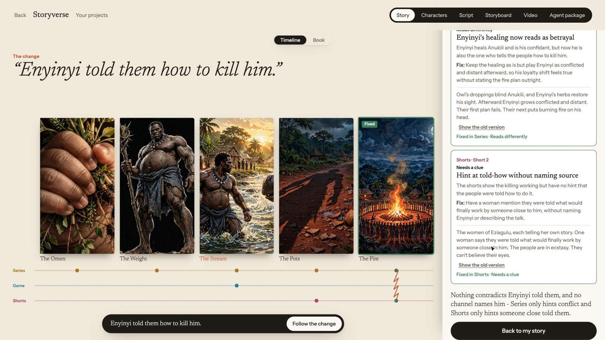
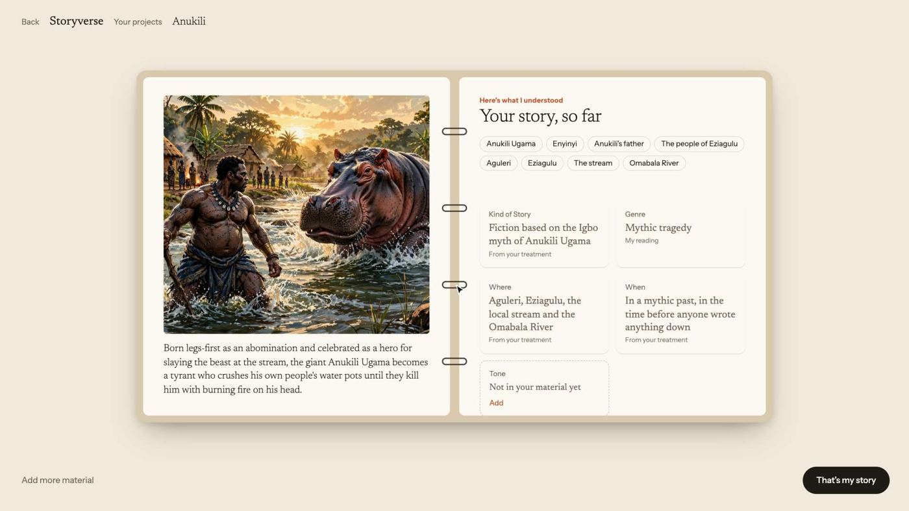
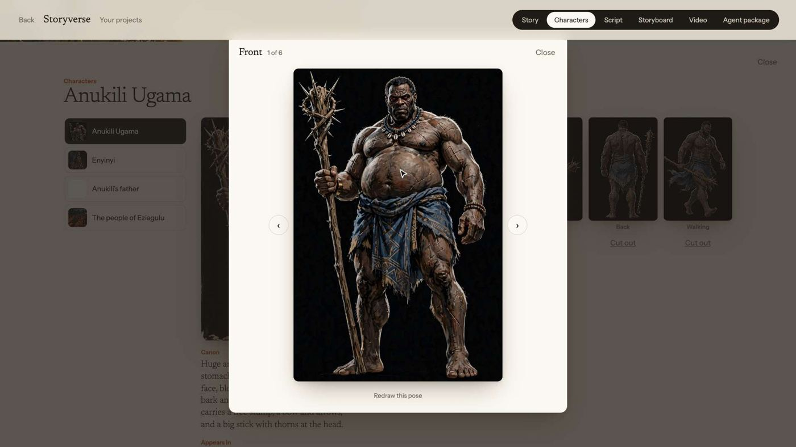
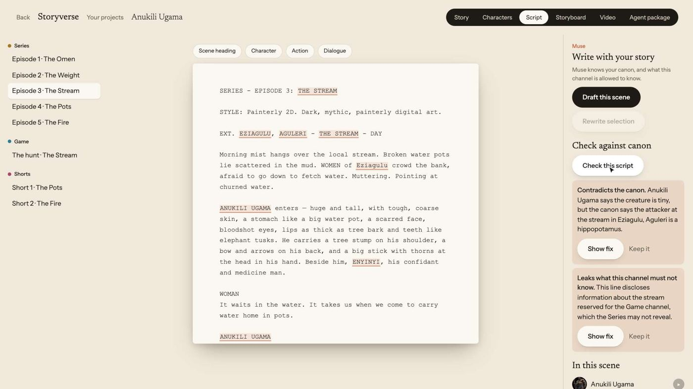
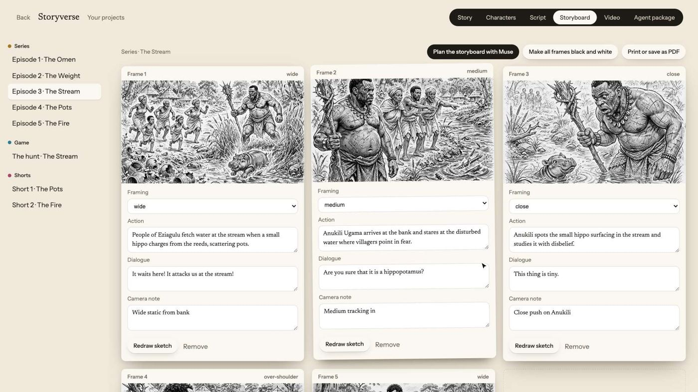
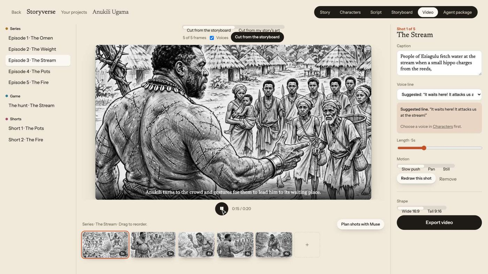
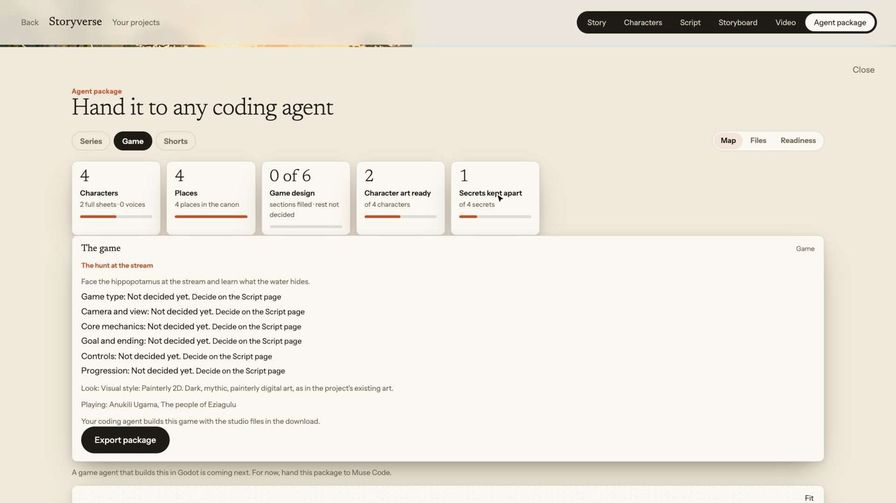
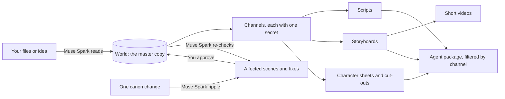

# Storyverse

**Change the story once, and every channel follows.**

Storyverse is a command centre for one story told across many channels: a series, a game, shorts and more. It holds a single master copy of your story world, gives each channel its own secret, and produces what each channel needs: character sheets, scene art, scripts, storyboards, character voices, short videos and packages for coding agents.

Change one fact and it finds every scene that breaks, in every channel, proposes the smallest fix, and checks the whole story again.

Built for the Meta Global AI Developer Hackathon with Muse Spark, Muse Image, SAM 3.1 and Muse Code. The demo story is **Anukili Ugama**, an Igbo myth.



## Contents

- [Why it exists](#why-it-exists)
- [What it does](#what-it-does)
- [Quick start](#quick-start)
- [Configuration](#configuration)
- [How to use it](#how-to-use-it)
- [How it works](#how-it-works)
- [Project structure](#project-structure)
- [Development](#development)
- [Deploying](#deploying)
- [Known issues](#known-issues)
- [Roadmap](#roadmap)
- [How this was built](#how-this-was-built)
- [Third-party software](#third-party-software)
- [License](#license)

## Why it exists

A creator telling one story across a game, a series and shorts rebuilds the same characters and retells the same story in every tool. Nothing shows which channel reveals what, and a change in one place silently breaks the others. Storyverse gives that creator one source of truth that every channel is made from.

It's for a solo creator or a small team telling one story in several places.

## What it does

| Area | What you get | Powered by |
|---|---|---|
| **Read your material** | Drop in text, PDFs and images. It finds the people, places and timeline, and the questions your story hasn't answered. | Muse Spark |
| **Start from an idea** | Begin with a premise instead of files. | Muse Spark |
| **Channels and secrets** | It splits the story across screens, so each one holds a secret the others don't. | Muse Spark |
| **The ripple** | State one change. See every affected scene and why, approve each fix, then get a re-check of the whole canon. | Muse Spark |
| **Timeline and Book views** | See the story as a timeline across channels, or read it as a book. | |
| **Character sheets** | Front, left, right and back views plus poses, all on-model, with a lightbox to view them. | Muse Image |
| **Cut-outs** | Transparent character images, ready for a game. | SAM 3.1 |
| **Scripts** | Draft a scene knowing what that channel may know, then check it against the canon. It flags contradictions and leaked secrets. For a game, the script page holds the game design. | Muse Spark |
| **Storyboards** | Plan a scene shot by shot, with greyscale pencil frames that keep characters on-model. You can reorder frames and print or save as PDF. | Muse Spark, Muse Image |
| **Short videos** | Cut a video from your storyboard frames or your story's art, then export it from the browser. | Remotion, Muse Spark |
| **Character voices** | Muse chooses a voice and writes the lines, and the provider speaks them. Custom voices are for the project owner. | Muse Spark, Fish Audio |
| **Agent packages** | Download a folder a coding agent can build from, holding only what that channel may know. A map, file list and readiness view change with the channel. | React Flow, JSZip |

<table>
  <tr>
    <td></td>
    <td></td>
  </tr>
  <tr>
    <td></td>
    <td></td>
  </tr>
  <tr>
    <td></td>
    <td></td>
  </tr>
</table>

## Quick start

You need [Node.js](https://nodejs.org/) and [pnpm](https://pnpm.io/). This was last tested on Node 24 and pnpm 10.

**1. Get the code and install**

```bash
git clone https://github.com/Sandgrouse/storyverse.git
```

```bash
cd storyverse
```

```bash
pnpm install
```

**2. Add your keys** (skip this to try the sample story)

```bash
cp .env.example .env.local
```

Open `.env.local` and set `MODEL_API_KEY`. You can create a key in the [Meta Model API dashboard](https://dev.meta.ai/). `.env.local` is ignored by git, so it won't be committed.

**3. Run it**

```bash
pnpm dev
```

Open [http://localhost:3000](http://localhost:3000). Press **Start your story** to begin, or go straight to the sample at [http://localhost:3000/projects/anukili/story](http://localhost:3000/projects/anukili/story).

### Running without a key

The app still runs. The Anukili sample story stays browsable, the ripple returns a result labelled **Sample result**, and generation features say they need a key. Sample mode makes no model calls.

## Configuration

Every setting is an environment variable, read only on the server. Keys never reach the browser.

| Variable | Needed for | Default |
|---|---|---|
| `MODEL_API_KEY` | All Muse Spark, Muse Image and SAM 3.1 features | None: sample mode |
| `FISH_API_KEY` | Character voices through [Fish Audio](https://fish.audio/), which needs API credit | None: voices are off |
| `ELEVENLABS_API_KEY` | Character voices through ElevenLabs ([untested](docs/KNOWN-LIMITATIONS.md)) | None |
| `VOICE_PROVIDER` | Forcing `fish` or `elevenlabs` | Fish if its key is set, then ElevenLabs |
| `VOICE_OWNER_CODE` | Custom voices, which only the owner can use | None |
| `VOICE_DAILY_CHARS` | Daily limit on characters spoken | `5000` |
| `DAILY_BUDGET_CENTS` | Daily spending cap across all visitors | `300` |
| `VISITOR_BUDGET_CENTS` | Daily spending cap per visitor | `60` |
| `BLOB_READ_WRITE_TOKEN` | Vercel Blob storage in production | None: local files and in-memory counts |

**The budget caps also apply on your own machine.** A long working session can reach the 60-cent visitor cap, and you'll see "You've reached the demo limit for today." Raise `VISITOR_BUDGET_CENTS` in `.env.local` and restart if that happens. The caps use estimated costs per request, so check your provider's billing page for real spend.

## How to use it

1. **Start a project.** Choose **I already have material** or **I have an idea** at `/projects/new`, or open the sample.
2. **Check what it understood.** Fill the gaps it found, keep some as secrets, then press **That's my story**.
3. **Choose your screens.** Accept, remove or add channels, then press **Open my world**.
4. **Try a change.** On the Story page, type a what-if and press **Follow the change**. Apply or keep each fix, and read the final verdict.
5. **Make the material.** Use the top bar:
   - **Characters:** make sheets and cut-outs, and find voices.
   - **Script:** draft and check a scene.
   - **Storyboard:** plan the shots and sketch the frames.
   - **Video:** cut from the storyboard, play it and export it.
   - **Agent package:** pick a channel and export its folder.
6. **Build with it.** Hand the folder to a coding agent such as Muse Code.

### What's in an agent package

A channel's package includes `AGENT_BRIEF.md`, `manifest.json`, and `canon/` (`world.md`, `timeline.json`, `secrets.json`). It also holds character canon, sheets, cut-outs and voices, plus each scene's brief, art, script and storyboard where you've made them. Only that channel's secret is included, and the others are left out. For a non-game channel, each short also gets an optional `raea/<part>/` folder (`edit.tsx`, `shots.ts`, `media/` art and voice lines, and a README) for creators who have [raea](https://raea.io/) installed and want a faster render of that short on their own machine.

A **game** package instead follows a game studio layout for Godot 4, with `design/` (game concept, narrative, art bible, character files, entity registry), `docs/`, `production/`, `assets/`, `scripts/setup-studio.sh` and `src/`. When the game channel covers at least one scene, it also holds an optional `raea/` starter where the game's character walks through its scenes, for creators who have [raea](https://raea.io/) installed.

### Custom voices

A project owner can make a character's voice from their own recording, an uploaded sample or a voice artist's recordings through an invite link (`/voice/[token]`). With Fish Audio, they can also describe the voice and let Muse imagine it.

- **Owner code.** These actions spend the owner's voice slots, so they need the `x-voice-owner-code` header, matching `VOICE_OWNER_CODE`. Ten wrong codes from one address in an hour returns a 429. The app keeps the entered code in `sessionStorage`, never in the world or the URL.
- **Consent.** Recording and uploading stay disabled until the owner confirms they have the right and the speaker's consent. Artists give their name and their own consent on the artist page, and that record is stored with the character's voice.
- **Saying names properly.** "How names are said" tells the voice how a name should sound (for example, "Enyinyi" as "eh-yin-yi"). Only spoken audio uses it, and the story keeps the real names.
- **Reading lines.** Muse Spark writes 8 to 12 lines from the story for the speaker to read. Secrets never reach that prompt.
- **Limits and storage.** Audio is at most 4 MB per file and 12 files per character per invite, and invites expire after 14 days. It's stored in Vercel Blob in production and in `.data/voice/` locally.

## How it works



**The world is the source of truth.** Everything hangs off one validated JSON document holding characters, places, parts, channels and secrets. Schemas are in `lib/world/schemas.ts`.

**Models used**

| Job | Model |
|---|---|
| Reading, planning, ripple, fixes, re-checks, scripts, shot plans, voice choices | Muse Spark 1.3 (`muse-spark-1.3`) |
| Character sheets, scene art, storyboard frames | Muse Image 1.0 (`muse-image-1.0`), anchored on reference images and chained with `previous_response_id` to stay on-model |
| Character cut-outs | SAM 3.1 (`sam-3.1`) |
| Speech, because Meta has no text-to-speech model | Fish Audio (ElevenLabs is an optional, untested alternative) |

**The stack:** Next.js 15 (App Router), React 19, TypeScript, Tailwind CSS and zod, with GSAP and Lenis for the landing page, Remotion for video, and Vitest for tests.

**Where data lives.** There are no accounts. Projects live in your browser, in `localStorage`, with images and audio in IndexedDB. Clearing your browser data removes them, and they don't sync between devices. Model calls run on the server through the API routes.

**Secrets stay apart.** Prompts and packages for a channel are built from what that channel may know, which is how a game package can hold only the game's secret.

**API routes** (all under `app/api/`)

| Route | Purpose |
|---|---|
| `read`, `facts`, `plan` | Read material, find story basics, plan channels |
| `ripple`, `ripple/apply`, `ripple/check` | Find what a change breaks, rewrite a scene, re-check the canon |
| `art/sheet-view`, `art/scene`, `art/cutout` | Draw a sheet view, draw a scene or sketch, cut out a character |
| `script/draft`, `script/check` | Draft and check scripts |
| `storyboard/plan`, `video/plan` | Plan storyboard frames and video shots |
| `pack` | Write a scene's working notes |
| `voice/*` | Suggest, list, speak, design and customise voices, and manage artist invites |

## Project structure

```text
app/              Pages and API routes
  api/            Server routes that call the models
  projects/       New-project flow and each project's pages
  voice/[token]/  Voice artist page
components/
  experience/     Story world, characters, onboarding scenes, sheet lightbox
  landing/        Scrolling landing page
  package/        Agent package dashboard and map
  projects/       Project context and top bar
  video/          Remotion player and composition
  voice/          Custom voice and recording
lib/              Logic: ripple, art, scripts, storyboards, video, package, budget, voices
  meta/           Meta API client
  storage/        Server storage
  world/          World schemas
data/seed/        The Anukili sample story and its sample ripple
public/anukili/   Sample story art and sheets
tests/            Vitest tests
docs/
  PRD.md              Product requirements
  tasks/              The task specs Muse Code built from
  design/             UI prototypes
  story/              The Anukili treatment
  submission/         Hackathon demo script and form answers
  KNOWN-LIMITATIONS.md
scripts/muse-task.sh  Runs one task spec through Muse Code
```

## Development

```bash
pnpm dev
```

```bash
pnpm test
```

```bash
pnpm lint
```

```bash
pnpm typecheck
```

```bash
pnpm build
```

Project rules for agents are in [`AGENTS.md`](AGENTS.md). Every task must pass lint, typecheck and build, and logic that isn't UI needs a test.

To run a task spec through [Muse Code](https://dev.meta.ai/):

```bash
scripts/muse-task.sh docs/tasks/001-foundation.md
```

The script needs a clean working tree. It runs the spec on its own branch and opens a pull request.

## Deploying

The app is designed for [Vercel](https://vercel.com/): import the repo, then add the variables from [Configuration](#configuration). In production:

- Set `BLOB_READ_WRITE_TOKEN`, so budgets, invites and voice audio survive restarts.
- Set `DAILY_BUDGET_CENTS` and `VISITOR_BUDGET_CENTS` to what you're willing to spend, because visitors would be using your keys.
- Set a spend alert with your model provider.

There's no public deployment of this repo yet, and the production setup above hasn't been tested end to end.

## Known issues

- **"Sketch the missing frames" keeps only the last sketch.** Use **Sketch this frame** on each frame instead. **Make all frames black and white** uses the same save code and may have the same problem.
- **Cut-outs can have holes,** especially where clothing or props meet the body. Use **Cut out again** to retry.
- **Toggle labels on the Video page** sit slightly below their track.
- **ElevenLabs is untested,** and **voice artist links need a deployed app.** See [Known limitations](docs/KNOWN-LIMITATIONS.md).
- **`tests/budget.test.ts`** has occasionally timed out in a full test run, and passes when run alone.

## Roadmap

These are directions, not promises, and there are no dates yet. Most come from what was deliberately left out of the hackathon build, listed in the [PRD](docs/PRD.md).

**Next: make what's here solid**
- [ ] Fix batch sketching and the other [known issues](#known-issues)
- [ ] Better cut-out quality
- [ ] A tested public deployment
- [ ] Test ElevenLabs against the live service, and test voice artist links on a deployment

**Then: from material to finished work**
- [ ] A game agent that builds the game package in Godot
- [ ] A small playable browser game built from an agent package by Muse Code
- [ ] Generated video clips from one outside provider, using the stored character sheets
- [ ] Deeper production for the Film and Website channels, which you can already add as screens

**Later: a platform for storytellers**
- [ ] Accounts, teams and saved projects that sync between devices
- [ ] Publishing straight to YouTube and TikTok
- [ ] Live connections to creative tools such as Firefly and Flow
- [ ] 3D character models
- [ ] Live voice conversations with characters
- [ ] Engagement analytics across channels

## How this was built

**During the hackathon:** all application code in this repo, from the first commit on Nov 3, 2026. **Before it:** the idea and the story. Anukili Ugama is an Igbo myth, and `docs/story/anukili-treatment.md` is an original retelling written for this project. All art in the repo was generated with Muse Image during the event.

Application code was written by Muse Code from the task specs in `docs/tasks/`, through pull requests. Specs, design prototypes and pull request reviews were by Claude Code, directed by the project's owner.

## Third-party software

| Software | Used for | License |
|---|---|---|
| [`@meta-sam/parser`](https://dev.meta.ai/) | Reading SAM 3.1 output | SAM License |
| [Fish Audio](https://fish.audio/) | Speech. The app sends it only the chosen voice and the line to speak. | Fish Audio terms |
| [ElevenLabs](https://elevenlabs.io/) | Optional speech provider, untested | ElevenLabs terms |
| [Remotion](https://www.remotion.dev/) (`remotion`, `@remotion/player`, `@remotion/media`, `@remotion/web-renderer`) | Short videos in the browser | [Remotion License](https://www.remotion.dev/docs/license): free for individuals and companies of up to three employees |
| [raea](https://raea.io/) | Optional faster renders of shorts on the creator's own machine; installed separately by the creator, not bundled with Storyverse | Source-available under its own licence (FSL-1.1-ALv2) |
| [GSAP](https://gsap.com/) (`gsap`, `@gsap/react`) | Landing page animation | [GSAP Standard License](https://gsap.com/standard-license) |
| [Lenis](https://lenis.darkroom.engineering/) | Landing page scrolling | MIT |
| [React Flow](https://reactflow.dev/) (`@xyflow/react`) | Agent package map | MIT |
| [JSZip](https://stuk.github.io/jszip/) | Package export | MIT or GPLv3 |
| [Claude-Code-Game-Studios](https://github.com/Donchitos/Claude-Code-Game-Studios) | The layout game packages follow, credited in each package's `STUDIO-NOTICE.md` | MIT |

## License

No open source license has been chosen yet, so all rights are reserved by default. The code is public so it can be read and reviewed. The Anukili Ugama myth belongs to its tradition, and the retelling and art here are part of this project.
